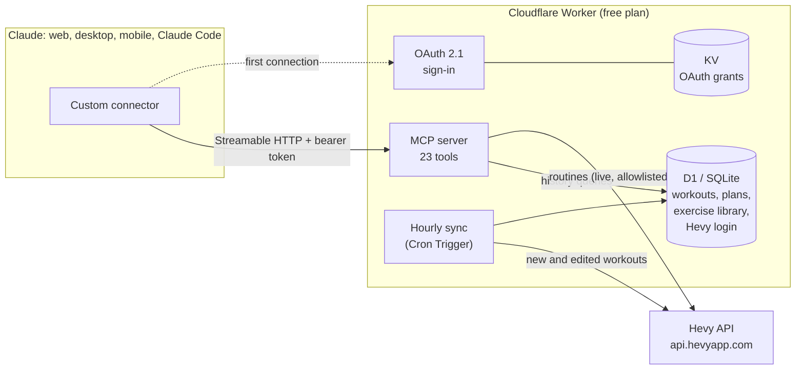
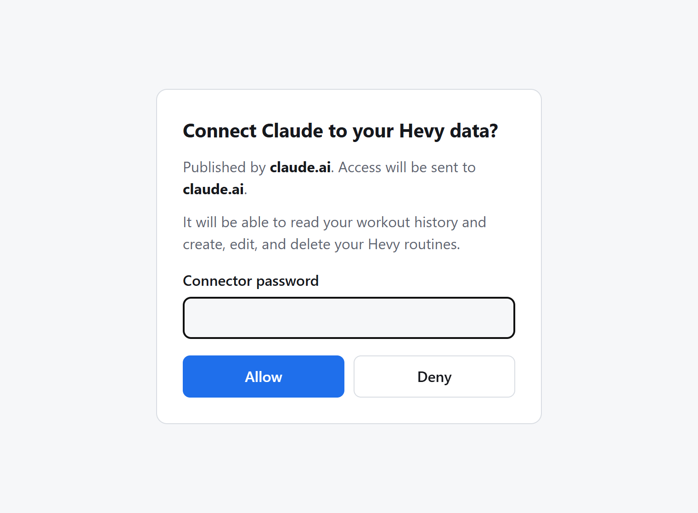
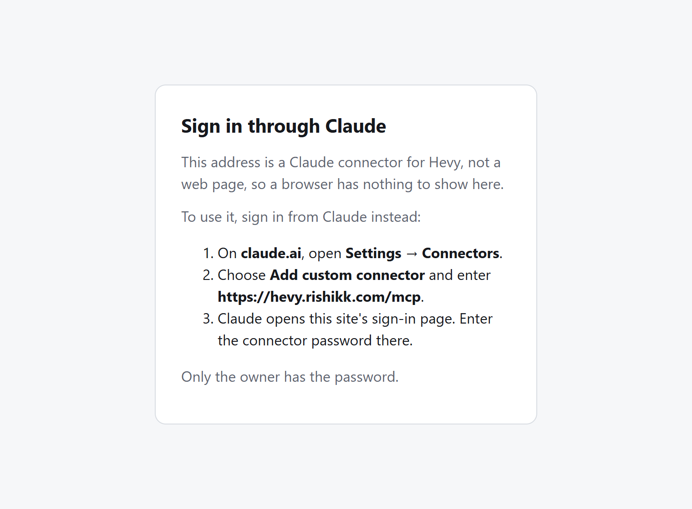

# hevy-mcp

**Ask Claude about your training, and let it build your [Hevy](https://hevy.com) routines.**

[](https://github.com/rishikk99/hevy-mcp/actions/workflows/ci.yml)
[](LICENSE)


hevy-mcp is a [Model Context Protocol](https://modelcontextprotocol.io) server that connects
Claude to a Hevy account. It runs as a free Cloudflare Worker, so it works as a custom connector
in Claude on the web, on desktop, and in the mobile app.

- **Your full training history, analyzed properly.** Volume that matches Hevy's own totals to
  the gram, working sets apart from warm-ups, personal records, and muscle balance.
- **Routines written straight into Hevy.** Claude picks real exercises from Hevy's library,
  shows you exactly what it will save, and writes it only after you agree.
- **Programs longer than the free plan allows.** Free Hevy accounts hold four routines. Plans
  live on the connector and load into Hevy one day at a time, and a whole folder can be set
  aside and brought back exactly as it was.

> [!NOTE]
> This is an unofficial, personal project, not affiliated with or endorsed by Hevy. It uses the
> same web endpoints hevy.com uses, which can change without notice. Workouts are strictly
> read-only, and the routine limit of free accounts is respected, never worked around.

---

## What it's like to use

*Illustrative examples. The connector answers from your own data.*

> **You:** How has my bench press moved since the summer?
>
> **Claude:** *(reads 3 months of bench sets)* Your top working set went from 125 × 8 in July to
> 140 × 8 last week, about 12% in 12 weeks. Volume dipped in late August when you trained twice
> a week instead of three times.

> **You:** Which muscles am I neglecting?
>
> **Claude:** *(compares primary and secondary muscle exposure over 90 days)* Glutes and calves
> never show up as a primary muscle. Glutes only get indirect work from leg press. A hip thrust
> or Romanian deadlift once a week would close most of that gap.

> **You:** Save my PPL folder, then replace it with a 4-week upper/lower block. Leave the
> weights empty.
>
> **Claude:** Saved "PPL" (3 routines, 73 sets) as a plan. Here's week 1 as it will appear in
> Hevy... *(preview)* Shall I write it?
>
> **You:** Yes. And bring PPL back when the block is over.

---

## What Claude can do with it

| Area | Tools | Notes |
|---|---|---|
| **History** | `get_workouts`, `get_workout_detail`, `get_exercise_history`, `get_personal_records`, `list_exercises` | Fuzzy exercise names ("bench press" finds *Bench Press (Barbell)*), times in your own time zone |
| **Analysis** | `get_volume_summary`, `get_muscle_exposure` | Tonnage by week or month, by muscle, exercise or equipment; exposure that counts secondary muscles too |
| **Sync** | `sync_workouts` | Hourly on its own; on demand right after a session |
| **Routines** | `list_routines`, `get_routine`, `search_exercises`, `save_routine`, `delete_routine`, folder tools | Every change is previewed first, and nothing is saved until you confirm |
| **Plans** | `save_plan`, `list_plans`, `get_plan`, `load_plan_day`, `delete_plan` | Multi-week programs stored on the connector, loaded into Hevy a day at a time |
| **Set aside and restore** | `save_routines_as_plan`, `restore_plan` | Exact copy of a folder, then back into the same routines, folder and order |

23 tools in all. The full reference is in [docs/TECHNICAL.md](docs/TECHNICAL.md#tools).

---

## How it works



- **History** is synced into D1 every hour and queried locally, so questions are fast and never
  touch Hevy. Routines are read live, because you edit them in the app too.
- **Sign-in:** claude.ai finds the authorization server through the 401 response, identifies
  itself with Anthropic's published client metadata, and sends you to the connector's own
  sign-in page once. After that it renews its own tokens.
- **The Hevy login** lives only in the database. Hevy rotates its refresh token on every use,
  so one copy, guarded by a lease, is the only safe arrangement.

<table>
<tr>
<td width="50%">
<picture>
  <source media="(prefers-color-scheme: dark)" srcset="docs/images/sign-in-dark.png">
  
</picture>
<p align="center"><sub>Sign-in page, opened by claude.ai on first connection</sub></p>
</td>
<td width="50%">
<picture>
  <source media="(prefers-color-scheme: dark)" srcset="docs/images/mcp-in-browser-dark.png">
  
</picture>
<p align="center"><sub>The MCP endpoint, visited in a browser</sub></p>
</td>
</tr>
</table>

---

## Engineering highlights

- **A protocol mapped by observation, not guesswork.** Read endpoints come from the
  [`hevy-unofficial`](https://github.com/Sahil624/hevy-unofficial) package. Routine writes were
  recorded from hevy.com's own editor with a Playwright script that strips credentials before
  saving anything. Hevy's exercise library isn't in its API at all; it's extracted from the web
  app's bundle.
- **Writes are allowlisted.** Every non-GET request is checked against the exact routine and
  folder endpoints before it leaves. No code path can create, edit or delete a workout, and a
  test asserts it.
- **Volume that reconciles with Hevy exactly.** Hevy adds bodyweight to some exercises' volume
  using a figure that isn't in the workout data. Solving for it from the history makes every
  workout match Hevy's `estimated_volume_kg` to 0.000000 kg.
- **A port proven equivalent.** The connector began as a local Python server and was ported to
  TypeScript. Equivalence tests replay the real history through both: every payload hash
  matches byte for byte (Python's `json.dumps` and banker's rounding are reproduced exactly),
  every normalized row matches, and 28 recorded queries return identical output.
- **A complete OAuth 2.1 server** on Cloudflare's `workers-oauth-provider`, with:
  - PKCE, and Client ID Metadata Documents, so the page can show the request really is Claude;
  - a redirect allowlist that admits only claude.ai, claude.com and loopback;
  - PBKDF2-hashed credentials and rate-limited attempts.
- **Concurrency handled explicitly.** A lease in D1 serializes every use of the rotating Hevy
  token across the cron job and interactive tools. Two overlapping refreshes would revoke each
  other.
- **A real bug, found in real use.** Workouts were dated in UTC, which put every evening
  session on the next day: a third of the history. Fixed with time-zone-aware dates, migrated
  in place, and covered by tests for winter time and the midnight boundary.
- **Free-tier engineering.** The free Workers plan allows 50 outbound requests per run, so sync
  checkpoints and resumes, and the history was seeded from the local cache rather than
  re-downloaded. Hosting costs $0.
- **351 tests** across Python (pytest) and TypeScript (Vitest). They run offline against a
  stateful fake of Hevy built from recorded requests, plus an in-memory D1 and KV.

---

## Set up your own

You'll need a Hevy account, a free [Cloudflare](https://dash.cloudflare.com) account with a
domain on it (the connector needs a subdomain such as `hevy.example.com`),
[Node.js 24](https://nodejs.org), Python 3.12+ and [uv](https://docs.astral.sh/uv/).

The helper scripts are PowerShell and were written on Windows. On macOS or Linux, use
PowerShell 7 or run the commands inside them by hand; they're short.

**1. Get the code and log in to Hevy locally**

```powershell
git clone https://github.com/rishikk99/hevy-mcp; cd hevy-mcp
uv sync
uv run hevy-mcp-authenticate   # opens a browser: log in by hand (Hevy's login has a CAPTCHA)
uv run hevy-mcp-sync           # downloads your history into .hevy/hevy.sqlite3
```

**2. Fill in your settings.** Set your time zone and the bodyweight from your Hevy profile in
`worker/src/config.ts` and `src/hevy_mcp/config.py` (the blocks marked *Your settings*).

**3. Create the Cloudflare pieces.** Create an API token from the *Edit Cloudflare Workers*
template, plus **D1: Edit** and **Zone DNS: Edit** for your domain. Save it as the environment
variable `CLOUDFLARE_API_TOKEN`. Then:

```powershell
cd worker
npm ci
npx wrangler d1 create hevy                 # copy the database_id it prints
npx wrangler kv namespace create OAUTH_KV   # copy the id it prints
```

Put both IDs and your subdomain into the lines marked `YOURS` in `worker/wrangler.jsonc`.

**4. Create the database and load it**

```powershell
npx wrangler d1 migrations apply hevy --remote
uv run python scripts/update_exercise_library.py library.sql   # Hevy's exercise library
npx wrangler d1 execute hevy --remote --file library.sql
uv run python scripts/export_to_d1.py history.sql              # your history, from step 1
npx wrangler d1 execute hevy --remote --file history.sql
Remove-Item library.sql, history.sql                           # personal data: don't keep it
```

**5. Deploy, choose a password, and hand over the Hevy login**

If Windows refuses to run the scripts, prefix each with
`powershell -ExecutionPolicy Bypass -File`.

```powershell
npx wrangler deploy
.\set-password.ps1    # prompts twice; only a PBKDF2 hash is uploaded
.\push-login.ps1      # moves your Hevy login into the database, then deletes the local copy
```

**6. Connect Claude.** On claude.ai, go to **Settings → Connectors → Add custom connector**
and enter `https://<your-subdomain>/mcp`. Claude detects the sign-in, opens your password
page once, and the connector then works on the web, on desktop and on your phone.

If Hevy ever logs you out, Claude says so. Run `.\worker\push-login.ps1` again; it opens the
Hevy login, checks it, and sends it up.

---

## Local mode

The original Python server still works on its own over stdio, for Claude Desktop or Claude
Code without any hosting. It covers the history and analysis tools (read-only) and an
`authenticate` tool that runs the browser login:

```json
{ "mcpServers": { "hevy": { "command": "uv", "args": ["--directory", "/path/to/hevy-mcp", "run", "hevy-mcp"] } } }
```

Hevy rotates refresh tokens, so a login can live in one place only. Once it has been pushed to
the Worker, use the hosted connector everywhere.

---

## Development

```powershell
uv run pytest                    # Python: 173 tests
cd worker; npm test              # TypeScript: 178 tests
npx tsc --noEmit                 # type check
```

Everything runs offline. Tests that compare the two implementations need your local history
(`.hevy/hevy.sqlite3`, and `worker/test/.golden.json` from
`uv run python worker/test/golden_queries.py`) and skip themselves without it, as in CI.

```
src/hevy_mcp/     Python: Hevy client, browser login, sync, normalization, queries, stdio server
worker/src/       TypeScript Worker: OAuth sign-in, MCP handler, tools, sync, plans
worker/migrations D1 schema
worker/scripts/   exercise library extraction, history export, time zone migration
scripts/          capture tools used to record Hevy's request shapes
docs/             technical reference and images
```

How it works in depth (sync, schema, volume rules, authentication, every tool):
**[docs/TECHNICAL.md](docs/TECHNICAL.md)**.

---

## Security and privacy

- **Nothing personal is in this repository.** Workout data, the Hevy login, the connector
  password and API tokens all live in `.hevy/` (gitignored), in Cloudflare secrets, or in your
  environment. Committed test fixtures are sanitized.
- **One owner per deployment.** Each person runs their own copy on their own Cloudflare
  account, so nobody hands their Hevy login to anyone else.
- **Sign-in:**
  - OAuth 2.1 with PKCE;
  - access tokens can only be sent to Claude's own addresses;
  - ten wrong passwords pause sign-in for an hour;
  - the password is stored only as a PBKDF2 hash.
- **Every change to your Hevy account is previewed and confirmed.** The Claude apps can also
  be set to ask permission before any tool that changes something runs.
- **One optional public endpoint, off by default.** Setting `PUBLIC_LAST_WORKOUT` to `"true"`
  publishes `/public/last-workout` for a personal website: a generic label (a split name like
  "Push", or the muscle groups worked), days ago, sets and minutes. Never the workout's own name,
  its time, exercises or weights.

## Credits

Read endpoints and the token refresh flow follow
[Sahil624/hevy-unofficial](https://github.com/Sahil624/hevy-unofficial). Hevy is a trademark of
its owners; this project is independent of them.

## License

[MIT](LICENSE)
